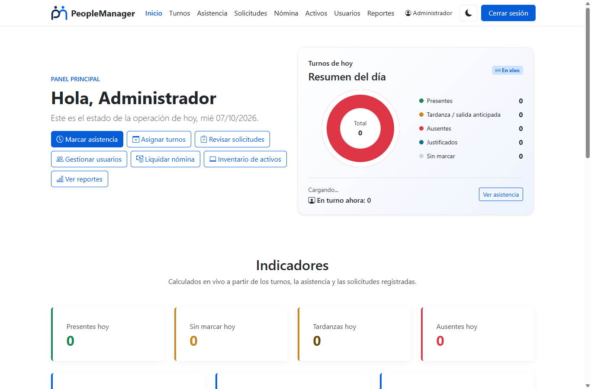
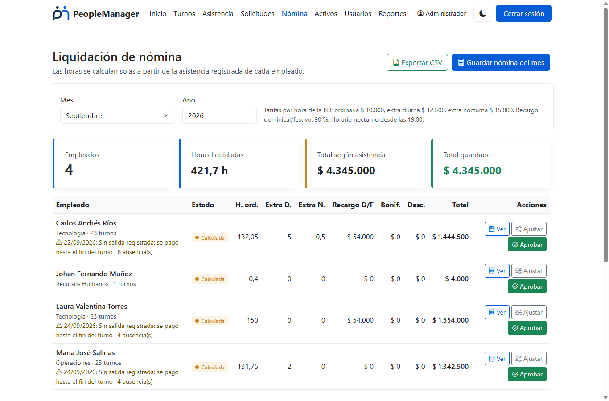
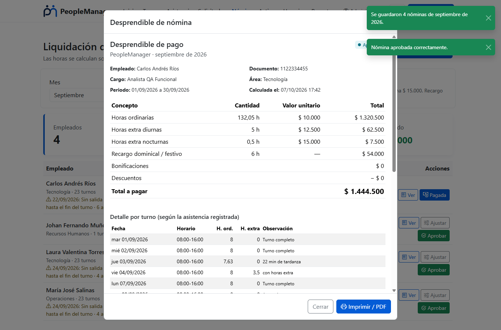
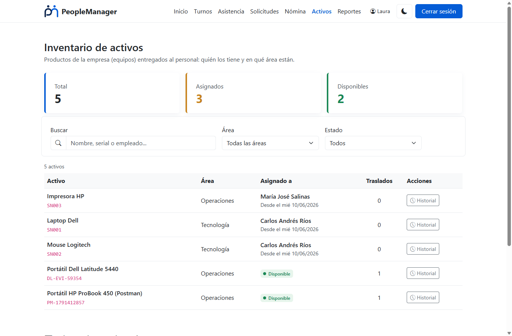
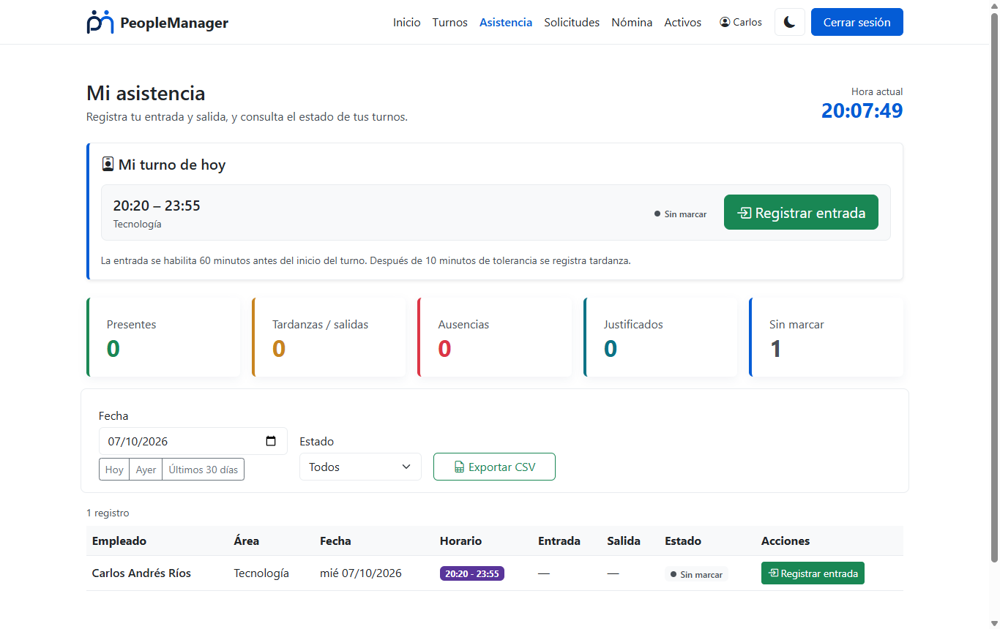
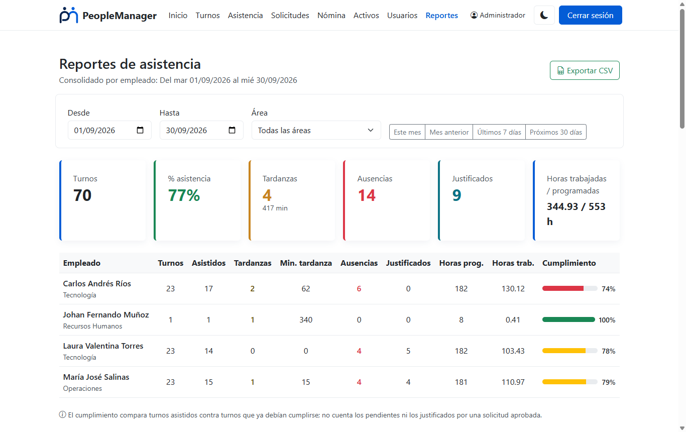
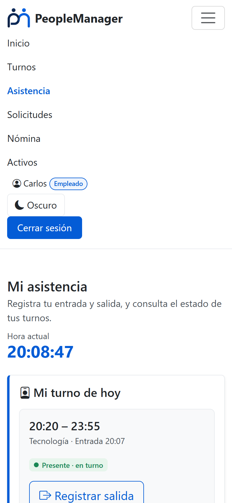
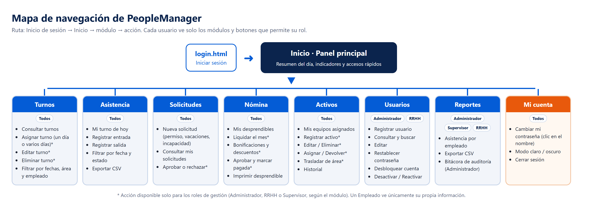

# PeopleManager

**Sistema web de gestión de talento humano**: turnos, asistencia, solicitudes, nómina, activos de la empresa, usuarios y reportes, con control de acceso por roles.

**Tecnologías:** Node.js · Express · PostgreSQL · JavaScript (POO + `fetch`) · Bootstrap 5 · `node:test` · Postman

| Inicio (panel en vivo) | Nómina calculada desde la asistencia |
|---|---|
|  |  |
| **Desprendible de pago** | **Inventario de activos** |
|  |  |
| **Mi turno de hoy** | **Reportes** |
|  |  |

<p align="center"></p>

### Puntos destacados

- **API REST con arquitectura MVC** y autenticación con token firmado (HMAC-SHA256) sin librerías externas; permisos por rol en cada endpoint.
- **Reglas de negocio reales**: tardanzas y ausencias calculadas, cruces de turnos, festivos de Colombia, recargos dominicales e incapacidades según la reforma laboral de 2025.
- **Sin cambios en el esquema de la base de datos**: los estados se calculan en SQL (`LEFT JOIN LATERAL`) y el total de la nómina lo genera una columna calculada de PostgreSQL.
- **Calidad**: 35 pruebas automáticas, colección de Postman con 63 peticiones, informe de pruebas y manual de usuario.
- **Seguridad**: bcrypt, bloqueo tras 5 intentos fallidos, consultas parametrizadas, escape de HTML (XSS) y auditoría de acciones.



> Proyecto formativo de **Johan Fernando Muñoz** — Técnico en Programación de Software, SENA.

📘 **[Manual de usuario (PDF)](docs/Manual_de_usuario_PeopleManager.pdf)** · 🧪 **[Informe de pruebas](evidencias/Informe_de_pruebas_PeopleManager.docx)**

---

## Documentación de la evidencia (GA4-220501096-AA1-EV02)

Sistema de gestión de talento humano: **turnos, asistencia, solicitudes
(permisos, vacaciones, incapacidades), nómina, usuarios, activos (productos) y reportes**. El front-end
(HTML/CSS/JS con Bootstrap 5) se conecta con la API REST del backend
(Node.js + Express + PostgreSQL) usando `fetch()` y clases de servicio (POO),
tal como lo pide la guía de la evidencia.

El diseño de la base de datos (esquema `pm`, con las tablas `usuarios`,
`turnos`, `asistencia`, `solicitudes`, `roles`, `areas`, `cargos`,
`tipos_solicitud`, `nomina`, `auditoria`, `activos`, `activos_asignados` y `asset_transfer_logs`) es el mismo de la evidencia de Bases de
Datos: **no se le cambió ni se le agregó ninguna columna**.

## Funcionalidades

| Módulo | Qué permite |
|---|---|
| **Inicio (dashboard)** | Resumen en vivo del día: presentes, tardanzas, ausentes, justificados y sin marcar; solicitudes pendientes, tardanzas del mes, empleados activos y aviso de cuentas bloqueadas. Se actualiza solo cada minuto. |
| **Turnos** | Asignar un turno o **varios días a la vez** (ej. lunes a viernes de todo el mes), con plantillas de horario. Filtros por rango de fechas, área y empleado. Valida cruces de horario, vacaciones aprobadas, fechas pasadas y jornada máxima de 12 h. |
| **Asistencia** | Panel **"Mi turno de hoy"** con reloj y botón de entrada/salida. Calcula tardanza (10 min de tolerancia), salida anticipada, **ausente** (el turno terminó sin marcar) y **justificado** (hay una solicitud aprobada ese día). Filtros y **exportación a CSV** (Excel). |
| **Solicitudes** | Permisos, vacaciones e incapacidades con cálculo de días. Flujo de aprobación con observación (obligatoria al rechazar). Evita solicitudes cruzadas; las incapacidades se pueden reportar hasta 30 días después. |
| **Nómina** | Liquidación mensual **calculada desde la asistencia real**: horas ordinarias, extra diurnas y nocturnas, recargo dominical/festivo (festivos colombianos calculados automáticamente), vacaciones, incapacidades al 66,67 % y ausencias. Vista previa, bonificaciones/descuentos con motivo, flujo calculada → aprobada → pagada y **desprendible de pago** imprimible. Cada empleado ve sus propios desprendibles. |
| **Activos (productos)** | Módulo de **gestión de productos** de la empresa: inventario de equipos (CRUD con serial único), **asignación** a empleados, **devolución**, **traslados entre áreas** con historial, exportación a CSV. Cada empleado ve los equipos que tiene a su cargo. |
| **Usuarios** | Crear, editar, desactivar/reactivar (eliminación lógica), **desbloquear cuentas** y **restablecer contraseñas**. |
| **Reportes** | Consolidado por empleado en un rango de fechas: turnos, asistidos, tardanzas, minutos de tardanza, ausencias, horas programadas vs. trabajadas y % de cumplimiento. Exportable a CSV. |
| **Auditoría** | Bitácora (`pm.auditoria`) de quién hizo qué y cuándo: usuarios, turnos, asistencia, solicitudes y bloqueos de cuenta. |
| **Mi contraseña** | Cualquier usuario la cambia haciendo clic en su nombre, en el menú. |

### Roles y permisos

La API exige un **token de sesión** en todas las rutas (excepto el login) y
revisa el rol en cada petición. El menú y los botones se adaptan al rol.

| Acción | Administrador | RRHH | Supervisor | Empleado |
|---|:-:|:-:|:-:|:-:|
| Ver sus propios turnos, asistencia y solicitudes | ✔ | ✔ | ✔ | ✔ |
| Marcar su propia entrada/salida y crear solicitudes | ✔ | ✔ | ✔ | ✔ |
| Ver los datos de todo el personal y marcar asistencia de otros | ✔ | ✔ | ✔ | — |
| Asignar, editar y eliminar turnos | ✔ | — | ✔ | — |
| Aprobar/rechazar solicitudes | ✔ | ✔ | ✔ (solo de su área) | — |
| Gestionar usuarios | ✔ | ✔ (no puede tocar Administradores) | — | — |
| Liquidar, ajustar, aprobar y pagar nómina | ✔ | ✔ | — | — |
| Registrar, editar, asignar y trasladar activos | ✔ | ✔ | — | — |
| Consultar inventario de activos e historial | ✔ | ✔ | ✔ | — |
| Ver sus propios equipos asignados | ✔ | ✔ | ✔ | ✔ |
| Ver sus propios desprendibles de pago | ✔ | ✔ | ✔ | ✔ |
| Reportes | ✔ | ✔ | ✔ | — |
| Bitácora de auditoría | ✔ | — | — | — |

Nadie puede aprobar sus propias solicitudes ni gestionar su propia nómina, desactivarse a sí mismo ni
cambiarse su propio rol.

## Estructura de la carpeta

```
PeopleManager_WebFuncional/
├── frontend/
│   ├── index.html, login.html, turnos.html, asistencia.html,
│   │   solicitudes.html, nomina.html, activos.html, usuarios.html, reportes.html
│   ├── css/estilos.css
│   └── js/
│       ├── services/    → ApiService (fetch + token) y un servicio por recurso (POO)
│       ├── script.js    → código compartido: sesión, roles, menú, utilidades
│       └── paginas/     → lógica de cada página
├── backend/
│   ├── config/          → conexión a PostgreSQL, cargador de .env, roles
│   ├── middlewares/     → autenticación/autorización y manejo de errores
│   ├── models/          → consultas SQL (acceso a datos)
│   ├── controllers/     → reglas de negocio
│   ├── routes/          → endpoints
│   ├── utils/           → token, fechas, validaciones, reglas de asistencia y de nómina
│   ├── tests/           → pruebas automáticas (npm test)
│   └── app.js
├── database.sql           → crea el esquema/tablas si no existen + siembra catálogos y un usuario admin
├── backup/
│   └── peoplemanager_dump.backup → respaldo del esquema pm con datos de prueba (formato Custom, PostgreSQL 18)
├── evidencias/
│   └── Informe_de_pruebas_PeopleManager.docx → resultados de las pruebas (npm test, Postman, permisos, PostgreSQL antes/después)
├── postman/               → colección de Postman con todos los endpoints y pruebas
└── README.md
```

## 1. Preparar la base de datos

Hay dos formas de tener la base de datos lista. Usa la que prefieras; no
hace falta hacer las dos.

### Opción A (recomendada): restaurar el respaldo (`backup/peoplemanager_dump.backup`)

Respaldo completo del esquema `pm` con datos de prueba: usuarios de todos
los roles, turnos de junio y **septiembre de 2026** con asistencia
(tardanzas, horas extra, domingos, una ausencia), vacaciones, una
incapacidad, un permiso y nóminas de ejemplo. Con estos datos el inicio, los
reportes y la nómina muestran información apenas se abren.

Está en formato **Custom** de PostgreSQL (binario, comprimido), hecho con
"Backup" de DBeaver sin dueños ni permisos, para que se restaure con
cualquier usuario.

1. En DBeaver, crea una base de datos **vacía** llamada `peoplemanager`.
2. Clic derecho sobre ella → **Herramientas → Restaurar backup** (Restore).
3. Formato **Custom**, selecciona `backup/peoplemanager_dump.backup`, marca
   **Discard objects owner** y **Do not restore privileges**, y ejecuta.

Desde la terminal es equivalente:

```
pg_restore -U postgres -d peoplemanager --no-owner --no-privileges backup/peoplemanager_dump.backup
```

**Requiere PostgreSQL 17 o 18** (el respaldo se generó con la versión 18).
Con una versión anterior aparece el error "unsupported version in file
header"; en ese caso usa la Opción B.

### Opción B: correr `database.sql` (crea todo desde cero, con datos mínimos)

1. Conéctate con DBeaver a una base de datos `peoplemanager` (vacía o no).
2. Abre `database.sql` en una consola SQL **conectada a esa base** y
   ejecútalo completo.
3. Esto crea el esquema `pm` y sus tablas (si no existen), siembra los roles
   (Administrador, Supervisor, Empleado, RRHH), áreas y tipos de solicitud, y
   crea el usuario administrador de prueba `admin@peoplemanager.com` /
   `admin123` (solo si no existe).

El script usa `IF NOT EXISTS`, `ON CONFLICT DO NOTHING` y `WHERE NOT EXISTS`,
así que se puede ejecutar varias veces sin duplicar nada ni dañar una base
existente.

## 2. Configurar y correr el backend

1. Entra a la carpeta `backend/`.
2. Copia `.env.example` a un archivo nuevo llamado `.env` y coloca tus datos:

   ```
   DB_HOST=localhost
   DB_USER=postgres
   DB_PASSWORD=tu_contraseña_real
   DB_NAME=peoplemanager
   DB_PORT=5432
   PORT=3000
   TOKEN_SECRET=una_clave_larga_y_aleatoria
   ```

   `TOKEN_SECRET` firma los tokens de sesión. Genera una con:
   `node -e "console.log(require('crypto').randomBytes(32).toString('hex'))"`.
   Si no la defines, el servidor genera una temporal y las sesiones se
   cierran cada vez que se reinicia.

3. Instala las dependencias y arranca:

   ```
   npm install
   npm start
   ```

   Si todo está bien, verás:

   ```
   Servidor escuchando en el puerto 3000
   Conexión con PostgreSQL (esquema pm) establecida correctamente
   ```

El backend solo usa tres dependencias: `express`, `pg` y `bcryptjs`. No
usa `dotenv` (trae su propio cargador en `config/env.js`) ni librerías de
tokens o CORS: el token se firma con el módulo `crypto` de Node.js y las
cabeceras CORS se agregan con un middleware propio.

## 3. Abrir el front-end

Abre `frontend/login.html` con la extensión **Live Server** de VS Code. La
URL de la API se configura en un solo lugar, `frontend/js/services/ApiService.js`:

```js
const API_BASE_URL = "http://localhost:3000/api";
```

## 4. Recorrido sugerido para probar el sistema

1. Inicia sesión como **Administrador**.
2. **Usuarios**: crea un empleado nuevo (contraseña de mínimo 8 caracteres
   con letras y números).
3. **Turnos**: asígnale un turno para hoy que incluya la hora actual, y otro
   con la opción "Varios días (mismo horario)".
4. **Asistencia**: registra su entrada. Si ya pasaron más de 10 minutos del
   inicio, queda como **tardanza**. Luego registra la salida.
5. **Solicitudes**: crea unas vacaciones para el empleado y apruébalas. Al
   intentar asignarle un turno en esas fechas, el sistema lo impide, y los
   turnos que ya tenía aparecen como **Justificado**.
6. **Nómina**: elige el mes anterior, revisa la vista previa (horas calculadas
   desde la asistencia), guarda la nómina, agrega una bonificación, apruébala y
   abre el desprendible. Luego márcala como pagada.
7. **Activos**: registra un equipo, asígnalo a un empleado, regístrale la
   devolución y trasládalo a otra área; abre su historial.
8. **Reportes**: revisa el consolidado del mes y exporta el CSV. Abajo está
   la bitácora de auditoría con todo lo que hiciste.
9. Cierra sesión y entra como el empleado: solo verá **sus** turnos,
   solicitudes y desprendibles aprobados, y no tendrá acceso a Usuarios ni Reportes.
10. Intenta entrar 5 veces con una contraseña incorrecta: la cuenta se
   bloquea. Desbloquéala desde **Usuarios** con el administrador.

## 5. Pruebas

Los resultados completos de todas las pruebas, con capturas de la interfaz y
las consultas a PostgreSQL antes y después de cada operación, están en
**`evidencias/Informe_de_pruebas_PeopleManager.docx`**.

### Pruebas automáticas del backend

```
cd backend
npm test
```

Usa el ejecutor de pruebas que trae Node.js (`node:test`, sin dependencias).
Cubre las reglas de asistencia (tolerancia, tardanza, salida anticipada),
el token de sesión (firma, alteración, expiración), las reglas de nómina
(festivos de Colombia, horas extra diurnas/nocturnas, recargo dominical,
incapacidad al 66,67 %/50 %), las validaciones y la
protección de la API (401 sin sesión, 404, JSON inválido, CORS). No escribe
nada en la base de datos.

### Postman

Importa `postman/PeopleManager-API.postman_collection.json` y ejecútala en
orden con el **Collection Runner**:

- `0. Autenticación > Login` guarda el token automáticamente en `{{token}}`
  (cambia el correo y la contraseña por los de un Administrador de tu BD).
- Las fechas se calculan solas (`{{manana}}`, `{{en10}}`…), así que funciona
  cualquier día.
- Cada petición trae su prueba del código esperado, incluidos los casos de
  error: **correo duplicado al actualizar → 409**, turnos cruzados → 409,
  solicitudes cruzadas → 409, rechazo sin motivo → 400, sin token → 401.
- La colección crea datos de prueba (un usuario, turnos y solicitudes) y al
  final desactiva al usuario creado.

## API REST

Todas las rutas (menos el login) requieren `Authorization: Bearer <token>`.

| Método | Ruta | Descripción |
|---|---|---|
| POST | `/api/usuarios/login` | Inicia sesión; devuelve token y datos del usuario con su rol |
| GET | `/api/usuarios/perfil` | Datos de quien tiene la sesión |
| GET | `/api/usuarios?estado=activo` | Lista usuarios (gestores) |
| GET/POST/PUT/DELETE | `/api/usuarios[/:id]` | CRUD (DELETE = desactivación lógica) |
| PUT | `/api/usuarios/:id/desbloquear` | Desbloquea una cuenta |
| PUT | `/api/usuarios/:id/password` | Cambia (propia) o restablece (admin/RRHH) la contraseña |
| GET | `/api/catalogos/roles` · `areas` · `cargos` · `tipos-solicitud` | Catálogos |
| GET | `/api/turnos?desde=&hasta=&fecha=&id_area=&id_usuario=` | Turnos con estado calculado |
| POST/PUT/DELETE | `/api/turnos[/:id]` | Crear, editar, eliminar turno |
| POST | `/api/turnos/lote` | Mismo horario en varios días |
| POST | `/api/asistencia/entrada` · `/salida` | Registrar entrada/salida (`{ id_turno }`) |
| GET | `/api/asistencia?desde=&hasta=&id_usuario=` | Historial con horas trabajadas |
| GET/POST | `/api/solicitudes[?estado=&id_usuario=]` | Listar / crear solicitudes |
| PUT | `/api/solicitudes/:id/aprobar` · `/rechazar` | Responder una solicitud |
| GET | `/api/nomina?anio=&mes=` | Vista previa de la liquidación del mes (Admin/RRHH) |
| POST | `/api/nomina/calcular` | Guarda la nómina del mes en `pm.nomina` (`{ anio, mes }`) |
| PUT | `/api/nomina/:id/ajustes` | Bonificaciones y descuentos (`{ bonificaciones, descuentos, motivo }`) |
| PUT | `/api/nomina/:id/aprobar` · `/pagar` | Avanza el estado de la nómina |
| GET | `/api/nomina/mias` · `/api/nomina/:id` | Mis desprendibles / desprendible con detalle por turno |
| GET/POST/PUT/DELETE | `/api/activos[/:id]` | Inventario de activos (CRUD); `GET /api/activos/mios` = mis equipos |
| POST | `/api/activos/:id/asignar` · `/devolver` · `/trasladar` | Entrega, devolución y traslado entre áreas |
| GET | `/api/activos/:id/historial` | Traslados y movimientos del activo |
| GET | `/api/reportes/resumen` | Datos del dashboard |
| GET | `/api/reportes/asistencia?desde=&hasta=&id_area=` | Consolidado por empleado |
| GET | `/api/auditoria?limite=&accion=` | Bitácora (solo Administrador) |

Los errores siempre responden en JSON `{ "mensaje": "..." }` con el código
adecuado: 400 (datos inválidos), 401 (sin sesión o sesión vencida), 403 (sin
permiso), 404 (no existe), 409 (conflicto: duplicado, cruce, ya procesado).

## Decisiones de diseño importantes

- **La base de datos real (`pm`) no se modificó.** No se agregó ninguna
  columna. El estado de un turno (pendiente, presente, tardanza, salida
  anticipada, **ausente**, **justificado**) se **calcula** en la consulta SQL
  a partir de `pm.asistencia` y `pm.solicitudes`, en el momento en que se
  pide; no se guarda, así nunca queda desactualizado.
- **Seguridad**: contraseñas con bcrypt; bloqueo tras 5 intentos fallidos
  (contador atómico en SQL); token firmado con HMAC-SHA256 que vence a las
  8 horas; la API vuelve a verificar en cada petición que el usuario siga
  activo (desactivar a alguien le cierra la sesión al instante); consultas
  parametrizadas (sin inyección SQL); escape de HTML en el front-end (sin
  XSS); el backend nunca confía en el `id_usuario` que envía el navegador
  para marcar asistencia o aprobar solicitudes, sino que lo toma del token.
- **Eliminación lógica**: los usuarios nunca se borran (`estado = 'inactivo'`),
  y los turnos con asistencia o de fechas pasadas no se editan ni se
  eliminan, porque son historial.
- **Hora local**: las fechas se manejan en la zona horaria local, no en UTC.
  Así se evita que después de las 7:00 p. m. el sistema crea que ya es el
  día siguiente.
- **No se pide ubicación GPS** al registrar asistencia; las columnas
  `latitud_entrada`, etc. quedan vacías.
- **Nómina sin alterar la BD**: el valor en pesos lo calcula la columna
  generada `pm.nomina.total_pagar`, con sus tarifas fijas por hora
  ($10.000 ordinaria, $12.500 extra diurna, $15.000 extra nocturna). El
  sistema llena automáticamente las horas a partir de la asistencia. Como la
  fórmula está en la base de datos, **no usa el `salario_base` del cargo**;
  es una simplificación del diseño de la evidencia de Bases de Datos.
- **Reglas de nómina aplicadas** (reforma laboral, Ley 2466 de 2025; conviene
  verificarlas si cambian): trabajo nocturno desde las 7:00 p. m.; recargo
  dominical/festivo del 80 % (jul-2025), 90 % (jul-2026) y 100 % (jul-2027);
  incapacidad por enfermedad general al 66,67 % hasta el día 90 y al 50 % del
  día 91 al 180; vacaciones pagadas completas; permisos no remunerados.
  Limitaciones: no distingue la incapacidad de origen laboral (ARL, 100 %),
  no aplica el piso del salario mínimo ni el recargo nocturno de horas
  ordinarias (la tabla no tiene columnas para eso), y no incluye aportes a
  seguridad social, auxilio de transporte ni prestaciones.
- **Activos**: usa las tablas `pm.activos`, `pm.activos_asignados` y
  `pm.asset_transfer_logs` que ya existían. Como `activos_asignados` no tiene
  columna de devolución, cada fila es la asignación vigente: al devolver un
  equipo la fila se elimina y la devolución queda registrada en
  `pm.auditoria`, que conserva el historial. Un activo asignado o con
  traslados no se puede eliminar.
- **Asistencia**: la salida solo se registra el mismo día del turno. Si un
  empleado no marcó la salida, la nómina le paga hasta el fin del turno y lo
  señala con una alerta.

## Antes de comprimir la carpeta para entregar

No incluyas en el .zip:

- `backend/node_modules/` (se regenera con `npm install`)
- `backend/.env` (contiene credenciales; cada quien pone las suyas a partir de `.env.example`)

## Usuarios de prueba

Funciona igual con el respaldo (Opción A) y con `database.sql` (Opción B):

| Correo | Contraseña | Rol |
|---|---|---|
| admin@peoplemanager.com | admin123 | Administrador |

Para entrar con otros roles (Supervisor, RRHH, Empleado), inicia sesión
como Administrador y, en **Usuarios**, usa el botón **Contraseña** para
asignarles una.
